

<picture><source media="(prefers-color-scheme: dark)" srcset="assets/hero-dark.svg"></picture>

<picture><source media="(prefers-color-scheme: dark)" srcset="assets/social-l-dark.svg"></picture><a href="https://t.me/pshlst"><picture><source media="(prefers-color-scheme: dark)" srcset="assets/social-1-dark.svg"></picture></a><a href="https://discord.com/users/654190262700212224"><picture><source media="(prefers-color-scheme: dark)" srcset="assets/social-2-dark.svg"></picture></a><a href="https://www.reddit.com/user/Peshcovv/"><picture><source media="(prefers-color-scheme: dark)" srcset="assets/social-3-dark.svg"></picture></a><picture><source media="(prefers-color-scheme: dark)" srcset="assets/social-r-dark.svg"></picture>

<picture><source media="(prefers-color-scheme: dark)" srcset="assets/about-dark.svg"></picture>

<picture><source media="(prefers-color-scheme: dark)" srcset="assets/stack-dark.svg"></picture>

<a href="https://github.com/peshk0v/Zapret-Zen"><picture><source media="(prefers-color-scheme: dark)" srcset="assets/project-zapret-zen-dark.svg"></picture></a>&nbsp;<a href="https://github.com/peshk0v/Zapret-Mods"><picture><source media="(prefers-color-scheme: dark)" srcset="assets/project-zapret-mods-dark.svg"></picture></a>

<a href="https://github.com/peshk0v/Zapret-Mods-Patcher"><picture><source media="(prefers-color-scheme: dark)" srcset="assets/project-zapret-mods-patcher-dark.svg"></picture></a>&nbsp;<a href="https://github.com/peshk0v/Arch-Dotfiles"><picture><source media="(prefers-color-scheme: dark)" srcset="assets/project-arch-dotfiles-dark.svg"></picture></a>

<picture><source media="(prefers-color-scheme: dark)" srcset="assets/stats-dark.svg"></picture>

<picture><source media="(prefers-color-scheme: dark)" srcset="assets/streak-dark.svg"></picture>

<picture><source media="(prefers-color-scheme: dark)" srcset="assets/wave-dark.svg"></picture>

<a href="https://t.me/pshlst"><picture><source media="(prefers-color-scheme: dark)" srcset="assets/button-1-dark.svg"></picture></a>&nbsp;&nbsp;<a href="https://github.com/peshk0v?tab=repositories"><picture><source media="(prefers-color-scheme: dark)" srcset="assets/button-2-dark.svg"></picture></a>

<a href="https://metawka.github.io/expressive-profile/?from=peshk0v"><picture><source media="(prefers-color-scheme: dark)" srcset="assets/credit-dark.svg"></picture></a>

